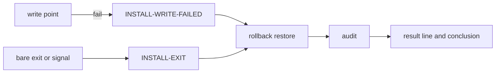

---
# Quality Chain Metadata
dispatch_id: p1-y4-1
dispatch_history: p1-y3-1
task_type: code
e2e_required: no
research_required: no
git_tracked_dirs: []
skip_knowledge_assessment: no
gate4_delta: []
risk_triggers: [platform, data]
look_first: .tad/evidence/yolo/v4011-failure-naming/phase1-look.md
real_paths:
  - id: RP1
    path: "An upgrade into a throw-away project whose path has a space and Chinese characters, with a real write fault (a read-only directory inside .tad), no shim"
    run: "In a temp dir: install the baseline tree into '目标 项目', chmod 555 one directory under .tad, run HOME=<temp>/home TAD_BACKUP_ROOT=<temp>/backups /bin/bash $SCR/tad.sh --source <staged next version> --platform codex --yes, keep the log; chmod back and rerun. uid 0: not-run, say so. Never run this without those two variables: the default backup root is the real ~/.tad-backups."
  - id: RP2
    path: "The field shape: an upgrade fails during sync in a project that already holds .tad-backup and two .tad-migrate-backup.* directories"
    run: "Same temp setup with those three directories made first and a PATH shim failing cp on one framework file. Set HOME and TAD_BACKUP_ROOT to temp paths as in RP1. Read the log the way the operator does; compare the project with its pre-run copy; remove the shim and rerun."
  - id: RP3
    path: "The same failure on the Muse VM overlayfs where the 4.0.10 failure happened"
    not-run: "the Epic binds forbid touching the Muse VM; the real scene is the next downstream release, which GM runs after this version ships"
---

# Handoff Document for Agent B (Blake)
## TAD v3.1 - Evidence-Based Development

**From:** Alex (Agent A - Solution Lead)
**To:** Blake (Agent B - Execution Master)
**Date:** 2026-11-02
**Project:** TAD Framework
**Task ID:** TASK-20261102-v4011-failure-naming
**Handoff Version:** 4.0.8
**Epic:** EPIC-20261102-v4011-failure-naming.md (Phase 1/1)
**Supersedes:** N/A
**Revision:** v2 (design fix after Gate 2 round 1; what changed is in §9.2)

---

## 🔴 Gate 2: Design Completeness (Alex必填)

**执行时间**: not yet run

Gate 2 is not claimed here. Cora dispatches the two reviewers (consistency; risk, because `risk_triggers: [platform, data]`), and their files on disk are the gate. Alex's own checks are recorded in §7.3, §9.1 and §9.3.

---

## 📋 Handoff Checklist (Blake必读)

Blake在开始实现前，请确认：
- [ ] 阅读了所有章节
- [ ] **阅读了「📚 Project Knowledge」章节中的历史经验**
- [ ] 所有"强制问题回答（MQ）"都有证据
- [ ] 理解了真正意图（不只是字面需求）
- [ ] 每个Phase的交付物和证据要求都清楚
- [ ] 确认可以独立使用本文档完成实现

❌ 如果任何部分不清楚，**立即返回Alex要求澄清**，不要开始实现。

---

## 1. Task Overview

### 1.1 What We're Building
Two changes to `tad.sh`, plus the tests and release text that go with them:
1. A failed write says which file, which step and what the system said. Any other exit says the last step, the exit status and that no specific reason was captured.
2. After a rollback, the installer prints one clear conclusion from what the rollback measured: the state of the project, whether a person has to act, and from which path.

### 1.2 Why We're Building It
**业务价值**: 4.0.10 failed in two downstream repos with no reason in the log, so the cause is still unknown and the third release attempt would be just as blind.
**用户受益**: The operator reads the end of one log and knows what happened and whether to touch anything.
**成功的样子**: A failed upgrade names its fault, and a fully restored project is reported as fine, even when it already holds an old `.tad-backup` (21 of 23 local repos do; see the look record, L2).

### 1.3 🆕 Intent Statement（意图声明）

**真正要解决的问题**: The log must be truthful and sufficient at the moment of failure. Finding the 4.0.10 root cause is not this phase's job.

**不是要做的（避免误解）**:
- ❌ Not a fix for the 4.0.10 root cause, which is still unknown.
- ❌ Not a fix for the `.codex/hooks.json` rollback gap. The prompt names the gap; it does not close it.
- ❌ Not a rollback speed-up, a heartbeat, or a change to the rollback's restore steps. The one new path is D17: a rollback whose snapshot never completed does not run those steps at all, because nothing has been written yet. Their code stays as it is.

**Blake请确认理解**: Conductor mode has no human relay. State your reading of these three points in the first lines of the completion report instead.

### 1.4 卸载记录（Offload Log）

无

### 1.5 Requirement (human's words)

See the Epic's `## Requirement`. This phase covers all its blocks: 失败点名, 回滚提示, 发布, Done check, Not wanted. The Epic's `### Assumptions` apply, and Gate 4 lists them. One of them is narrowed by design: see D8 for where the kept stage lives.

The Epic's two human rulings of 2026-11-02 (`## Notes`) replace older wording:
- Regression is judged by "不新增失败": every entry that passed on the baseline still passes, aw and the new cases all pass, and every entry already red is named in the completion report **and** the release note. This replaces "全绿" and EAC10's `RUN-ALL: PASS`.
- Tests run in a throw-away clone of the public repo overlaid with this folder, for this Epic only. Nothing is committed or pushed from it, and no git runs in this folder.

---

## 📚 Project Knowledge（Blake 必读）

**⚠️ MANDATORY READ — Blake 在开始实现前，必须执行以下 Read 操作：**
1. Read the pattern files in 步骤 2.
2. Read the lessons listed below.

### 步骤 1：识别相关类别

- [x] code-quality
- [x] testing
- [x] architecture (rollback contract)
- [ ] security, ux, performance (only NFR1), api-integration, mobile-platform

### 步骤 2：历史经验摘录

| 文件 | 相关记录数 | 关键提醒 |
|------|-----------|----------|
| patterns/shell-portability.md | 5 | bash 3.2 semantics; the tool shell is zsh; EXIT trap, not ERR |
| patterns/ac-verification.md | 4 | Loud failures must stay loud; baselines by sha; a fixture needs a witness |
| patterns/release-sync.md | 2 | Stamp every carrier; the installer's own print is what a session sees |
| patterns/gate-design.md | 1 | A consumer-tolerant parser hides a producer bug |
| principles.md | 1 | Measure before optimizing |

**⚠️ Blake 必须注意的历史教训**:

1. **`trap ERR` does not fire inside a `case` branch** (shell-portability.md). ACTION dispatch is such a branch, which is why rollback sits on EXIT. Do not add anything that relies on ERR.
2. **The Bash tool runs zsh** (shell-portability.md). Run every fixture with `/bin/bash`, as §9.1 does.
3. **`[ -e ]` is false for a dangling symlink** (shell-portability.md). The audit in D6 must test `-L` too, or it reports a restored dangling link as missing.
4. **Heredoc and quoting in shell code** (shell-portability.md, plus look L6). A heredoc with an apostrophe inside `$( )` breaks the whole file on bash 3.2.
5. **`grep` no-match in a command substitution under `set -e`** (shell-portability.md). The rollback runs inside the EXIT trap with `set -e` still on, so any new helper there can kill the rollback midway. New code in the rollback path must not be able to exit early.
6. **Repairing a loud failure must not replace it with a silent success** (ac-verification.md). Capturing `cp` output must not hide warnings on success. See D2.
7. **Before/after baselines are named by sha, not by HEAD** (ac-verification.md). The baseline hashes are in §7.3.
8. **A fixture needs a witness that the behaviour ran** (ac-verification.md). Each case asserts that the marker or fault fired.
9. **A scratch candidate must stamp every carrier** (release-sync.md). See D13.

### Blake 确认

- [ ] 我已阅读上述历史经验
- [ ] 我理解需要避免的问题
- [ ] 如遇到类似情况，我会参考上述解决方案

---

## 🔧 Capability Pack References

No pack loaded. Checked `.agents/skills/*/SKILL.md` and the registry: the only keyword hit is `web-testing` ("testing", "test"), whose rules cover browser, API and accessibility testing, not a bash installer fixture. It is not escalated, so no pack criteria are merged into §9. `code-security` was considered too: the phase adds no input handling beyond printing paths.

---

## 2. Background Context

### 2.1 Previous Work
- `.tad/archive/handoffs/HANDOFF-20261101-installer-atomicity.md`: the atomic write helpers and per-entry rollback accounting.
- `.tad/active/TICKET-20261102-hooks-json-rollback-gap.md`: the open gap. Hard constraint: `.codex/hooks.json` stays in aw.4's named set.
- `.tad/evidence/yolo/v4011-failure-naming/intake-details.md`: the seven findings the Epic's EACs rest on.

### 2.2 Current State
Facts below are from `.tad/evidence/yolo/v4011-failure-naming/phase1-look.md` (L numbers) or from `tad.sh` at the baseline sha in §7.3.

- The field log goes from `Syncing framework files` straight to `Installation failed` with nothing in between (L1). So the failure printed no message of its own.
- `.tad-backup` exists in 21 of 23 local repos (L2), so the false `partial` hits almost every upgrade failure.
- A run can add entries inside a `.tad-backup` that already existed (L3).
- In aw.4, `.codex/hooks.json` ends up **missing** after rollback, with bytes in the snapshot and in `.tad-backup/<from>-to-<to>-deprecations/` (L5). `.tad/brain-index.md` sometimes differs and sometimes does not (L5).
- `$?` in the EXIT trap reads 0 on a signal and on an unbound variable (L6).

- **Regression baseline, measured 2026-11-02 on this Mac** (`.tad/evidence/yolo/v4011-failure-naming/phase1-baseline-partial.txt`; the run was stopped after 18 of the entries, so this is a floor): overlay on a public clone, `TAD_TEST_FULL=1`:
  - `check-path-refs` fails with 18 dangling references. A pristine clone of public at `3572217c` also reports 18.
  - `installer-data-safety-fixture --case all` fails at `ac2.8`, `post-rollback drift: Only in target: .tad-migrate-backup.<ts>`. The pristine clone fails the same way. The run then ends after `fx.c`, as `run-all.sh`'s comment says.
  - rel-prep-1 recorded 4.0.10 with `RUN-ALL: FAIL (check-path-refs)` in default mode, and full mode was not run for it.
  - The same partial log also has `fx.k: k1 a non-pattern name under the group` failing. It is one more baseline red, not in the `FAILED` list only because the run was stopped there.
  So the regression is judged by the human's ruling, "不新增失败" (§1.5, AC14). The complete baseline list comes from micro-task 1.
- **Snapshot failure, measured by the risk reviewer on the baseline** (`scratchpad/riskrun/run.log`): with `mktemp` failing for `tad-rollback*`, the rollback deleted a pre-existing `.codex/config.toml` and `.agents/skills/mine`, then printed `ROLLBACK-RESULT: full … failed=0`. `ROLLBACK_PRE_TOP` was still empty, so step 4b read those directories as created by this run. Read, not run: `BACKUP_PATH_ABS` is set inside the same function, and step 1 reads an empty value as a fresh install and removes `.tad/`, so a signal between `NEED_ROLLBACK=1` and that line has the same shape. No test covers either (`grep` over `.tad/tests` finds no reference to the snapshot function). D17 closes this.

**Assumptions (not seen):** Linux bash and GNU tools behave like L6 except for the wording of `cmp`. Nothing outside this repo parses the installer's rollback text.

### 2.3 Dependencies
None new. No package is installed.

---

## 3. Requirements

### 3.1 Functional Requirements
- FR1: Every write point in the Epic's Scope prints one failure line before the rollback starts (EAC1–EAC4).
- FR2: Any other exit with `NEED_ROLLBACK=1` prints a catch-all line (EAC5).
- FR3: Verification-failed and swap-failed stage bytes are kept where they survive the rollback, and the log's final statement about them is true (EAC6).
- FR4: The rollback prints one conclusion from measured results, for every scenario in EAC7 and for each copy, verify and swap fault of the Done check, and passes the mechanical check.
- FR5: Known gaps are named, not hidden (EAC8).
- FR6: The aw cases are version-independent real upgrades, and run by name in `run-all.sh` (EAC9).
- FR7: Full regression shows no new failure against the baseline before and after the version bump, and the pre-release gates hold as split in AC16 (EAC10 as ruled, §1.5).
- FR8: Release text and carriers are ready for the release dispatch (EAC11), and the release note names every entry already red (§1.5).
- FR9: A rollback that starts before the snapshot completed deletes nothing and does not say the project was verified (D17).

### 3.2 Non-Functional Requirements
- NFR1: Bash 3.2 only. On a clean upgrade, wall-clock time for `aw.3` may grow by at most 25% against the baseline tree, measured as the better of two runs on each side, with the new fixture on both sides so that both are real upgrades (the old fixture's aw.3 is a same-version no-op), and written to the completion report. Over that is a finding, not a silent pass.
- NFR2: `tad.sh` gets no branch that exists only for tests. Faults come from PATH shims or real system conditions.
- NFR3: Reason capture writes no temp file, so it still works on a full disk.

---

## 4. Technical Design

The code bound applies: decisions here, code in `tad.sh`.

### 4.0 Decisions

| # | Decision | Lands in | Accepted by |
|---|---|---|---|
| D1 | One failure line format: fixed prefix `INSTALL-WRITE-FAILED`, then `step=<step> file=<target-relative path> reason=<one line>`, with the reason last. It is printed with `printf %s`, never through `log_error`, whose `echo -e` corrupts backslashes in paths (look L6). Multi-line text is joined with ` \| ` and nothing is cut. An empty reason prints `no message from the system`. The path drops a leading `./` or `$TARGET_ROOT/`. | `tad.sh`, a new helper | AC1, AC2 |
| D2 | Step names: `copy`, `verify`, `swap`, `mkdir`, `link-stage`, `link-swap`, `pack-meta-stage`, `hooks-stage`, `stamp-verify`. EAC 步骤=复制/校验/换入 map to `copy`/`verify`/`swap`, and the pack meta and hooks swaps of D8 also use `swap`; the log stays English like the rest of the installer. `cp` and `mv` are captured with `$( … 2>&1)`. A successful command that printed something still gets that text passed to the log, so warnings stay visible. | `atomic_install_file`, `atomic_install_tree`, `atomic_stamp_version` | AC1, AC3, AC4, AC5 |
| D3 | Verify failure: keep the fast `cmp -s` for the success path; only on failure run `cmp` again without `-s` and add both byte counts. The check does not pin `cmp`'s wording (BSD and GNU differ), only that its text and both counts appear. | `atomic_install_file` | AC3 |
| D4 | Pack meta and hooks stages capture the shell's own redirect error, measured to work without a temp file (look L6). Pack meta moves its block body into a function so no large block sits in `$( )`. The hooks JSON is read with `IFS= read -r -d ''` from its heredoc and then written with `printf`, never a heredoc inside `$( )`, because that can break parsing of the whole file on 3.2. The written bytes must stay identical to the baseline output. | `generate_pack_meta`, hooks block near L2926 | AC5, AC20 |
| D5 | Catch-all. The trap's first statement saves `$?` and `$BASH_COMMAND` (measured right in L6; `$LINENO` is wrong, do not use it). Traps for INT, TERM and HUP record the signal and exit with 128+n, since `$?` reads 0 otherwise. A step variable is set at each stage boundary, at least: backup, snapshot, sync-tad-top, sync-tad-dirs, sync-skills, sync-root-files, hooks, migration, verify, stamp, brain-index, projection. When no failure line was printed, the start of the rollback prints `INSTALL-EXIT step=<last step> status=<n or signal> last-command=<source text> reason=not captured`. It names no file as the failed one; `last-command` is labelled as unexpanded source text. A status of 0 prints as `unavailable`. The first statement of `rollback_on_failure` is `trap '' INT TERM HUP`, so a second signal cannot stop a restore midway and lose the conclusion; one log line says so. SIGKILL stays available to the operator. | EXIT trap at L4227, `rollback_on_failure`, stage callers | AC6 |
| D6 | Post-rollback audit. After all restore and removal steps, re-check each **file** entry of the snapshot manifest against the live tree, plus `.tad/brain-index.md` against a pre-run copy put in the snapshot directory under a name outside the manifest. Testing `-L` first. Directories are not re-walked: `restore_dir_entry` already verified them, and rollback time is not to grow. Each difference becomes a named exception with the path holding the pre-run bytes. A pre-run copy that could not be made is recorded in `ROLLBACK_AUDIT_GAPS` (the statement carries `|| …` and cannot exit), and the audit reports each gap as an exception, never as a pass. A file absent before the run is recorded as absent, which is not a gap. Nothing is restored by the audit. The ticket's gap stays as it is. | `rollback_on_failure`, `take_rollback_snapshot` | AC8, AC10 |
| D7 | Recovery copies. Record at snapshot time which `.tad-migrate-backup.*` exist and which top-level entries `.tad-backup` holds. At the end, `preserved=` counts only what this run added plus a backup kept after a failed restore. Older copies are listed as `left-untouched` and affect nothing. A listing that fails goes to `ROLLBACK_AUDIT_GAPS` the same way (D6): this run's entries then cannot be told apart, and that is the exception. These records are made at the top of `take_rollback_snapshot` (D17). The coverage label `preserved-for-manual-recovery` becomes `recovery-copies-from-this-run`. | `take_rollback_snapshot`, step 4d, coverage line | AC8 |
| D8 | Kept stage location: `$ROLLBACK_SNAP/.failed-stage/`, copied with `cp`, confirmed with `cmp`, then the stage in the target is removed. The helper keeps only when `ROLLBACK_SNAP` is non-empty, is a directory and has the basename `tad-rollback.*`, so it can never write `/.failed-stage`; otherwise it takes the keep-failed branch below. Reasons: the sweep and the directory restore remove anything inside the target (intake finding 5), the backup root is not resolved on a fresh install and has its own classifier (look L4), and the snapshot exists on every armed path and is restored by manifest only. The log says it lives in temp and is not reboot-safe. If keeping fails: say so with the reason, remove the stage, and print that the bytes are gone. If removal also fails, name the leftover path as an exception. This narrows the Epic's assumption "目标目录可能多一个残留文件": a leftover only remains in that double failure. Gate 4 lists it. | new helper, `atomic_install_file`, pack meta and hooks swap | AC7 |
| D9 | `failed=` counts: backup entries, snapshot entries (moved out of the kept list), a refused backup path (`.tad/ (refused)`) and a refused target root (`target-root (refused)`). Each is named. | `rollback_on_failure` | AC8 |
| D10 | Result line keeps its shape and adds a field: `ROLLBACK-RESULT: <full\|partial\|none> restored= failed= removed= preserved= exceptions=`. `none` iff nothing was restored or removed and (failed≥1, or the rollback was skipped by D17). `full` iff failed=0, exceptions=0 and not skipped. Otherwise `partial`. `exceptions=` counts audit differences and audit gaps. Copies from this run are `preserved=`; they do not lower `full`. | `rollback_on_failure` | AC8, AC10 |
| D11 | The conclusion is always the last output, after `Rollback complete.` (the `Please check logs` half is dropped), printed with `printf %s`: `PROJECT-STATE: intact\|intact-with-exceptions\|not-intact — <sentence>`, where `not-intact` iff failed≥1, `intact-with-exceptions` iff failed=0 and (exceptions≥1, or preserved≥1, or skipped by D17), and `intact` otherwise; one `exception:` line per counted exception, one `left-by-this-run: <path>` line per copy in `preserved=`, `ACTION-NEEDED: no\|yes — <what>`, `RECOVER-FROM: <path>` one line per path with nothing after it (or `RECOVER-FROM: not needed`), and `KEPT-STAGE: <path>` or `KEPT-STAGE: not kept — <reason>` when a stage was involved. The kept path is tested with `-e` at that moment. Matrix in §4.3. | `rollback_on_failure` | AC8, AC9 |
| D12 | `MANUAL-RECOVERY` prints iff `ACTION-NEEDED: yes`. It keeps the lines the aw cases read (`backup: /path — …`, `snapshot: /path — …`, `failed entries: …`). A consumed backup prints no path. `failed entries:` prints only with failed≥1. Target-root-unsafe no longer exits without a result: it prints the result line and conclusion first. | `rollback_on_failure` | AC8, AC9 |
| D13 | Version source in the aw cases: pre-run = the staged tree's `.tad/version.txt`; target = its patch number plus one, computed in one helper, failing loudly on a non-SemVer value. aw.3 additionally asserts pre-run differs from target and that the log shows the upgrade. aw.3 prints `aw.3: real upgrade <pre> -> <target>` as its witness. Only literals and this guard change in the aw functions. New checks go in new cases: `aw.guard` calls the guard with equal versions and with a non-SemVer value and passes only if it fails loudly both times, using no `4.0.x` literal. Carriers in the candidate: the `tad.sh` `TARGET_VERSION`, the `AGENTS.md` `Runtime status` line (in `$SCR`'s copy too, since the overlay skips that file), and everything `version-sweep` requires (listed in §7.2), with the triage at `.tad/evidence/releases/4.0.11-version-triage.md`. `NEXT.md`, the hop manifest and provenance regeneration belong to the release dispatch, which works in a clone of the public repo. | fixture, carriers | AC11, AC12, AC16 |
| D14 | New fixture cases, listed by name in `run-all.sh`: `fn.copy fn.copy-real fn.verify fn.swap fn.points fn.catchall fn.signal fn.keep fn.keep-lost rp.field rp.run-copy rp.backup-entry rp.snap-entry rp.unsafe-backup rp.unsafe-root rp.fresh rp.stamp rp.snap-incomplete rp.snap-pending rp.precopy-lost rp.lint-control aw.guard`, plus `aw.1 aw.2 aw.2b aw.3 aw.4`. Each `rp.*` and each `fn.*` that reaches a rollback (`fn.copy fn.verify fn.swap` at least) runs one shared lint over its log (the mechanical list in EAC7) and asserts `PROJECT-STATE` and `ACTION-NEEDED`, so the Done check's copy, verify and swap faults are judged on their conclusion too. The lint prints `LINT-RULE-FAILED: <rule>` for each broken rule. `rp.lint-control` feeds the lint the field-shaped text, which must FAIL. `fn.signal` sends a second TERM once `Installation failed` is in the log, and the conclusion must still print. `rp.snap-incomplete`: real run, shim failing `mktemp` for `tad-rollback*`, project holding `.tad`, `.codex/config.toml` and `.agents/skills/mine/SKILL.md`; those bytes survive, and the conclusion is the D17 one. `rp.snap-pending`: extracted `rollback_on_failure` with the D17 flag set and `BACKUP_PATH_ABS` empty; `.tad` survives. `rp.precopy-lost`: shim failing `cp` only for the brain-index pre-run copy; the run goes on and the exception is named. Each `fn.*` asserts a unique marker that the fault emitted. Rollback helpers must also work when extracted: `ac2.8` and others source `rollback_on_failure` alone with stubs, so either extend `fx` extraction lists and stubs, or keep the logic inline. | fixture, `run-all.sh` | AC1–AC10, AC13 |
| D15 | Release text. `docs/releases/v4.0.11-release.md` and a `[4.0.11]` section at the top of the folder's `CHANGELOG.md`, in the same form as earlier ones, with: what was fixed, what is still unknown (4.0.10's cause; VM overlayfs, not reproduced on Mac), the two open tickets, and a section naming every entry in `phase1-runall-baseline.failed` as already red on 4.0.10, with what is known of each (the human's ruling, §1.5). The folder's CHANGELOG lacks public `[4.0.10]` and still says `[4.0.9] - Unreleased`. Do not repair that here; say in the completion report that the release overlay must keep public's entries (rel-prep-1 restored the same by hand). Push, tag and publish are not yours. | release files | AC15 |
| D16 | Where tests run. Measured: the full regression cannot run in a plain copy. Without git, 24 entries fail. In a throw-away `git init` the classify, salvage and reprove cases still need real tags (`v4.0.3`, `v3.0.0`) and commit `165b2a39`. So `$SCR` and `$BASE` are each a fresh clone of the public repo `github.com/Sheldon-92/TAD` with this folder overlaid by the rel-prep-1 rule (`rsync` without `--delete`, excluding `.git .worktrees .yunpush.conf 同步与推送.md LARGE-FILES.md AGENTS.md .tad/evidence .private .env* archive docs/pm`), nothing staged, committed or pushed. Right after cloning: `git remote set-url --push origin DISABLED`, which makes the no-push bind a property of the tree and leaves the fetch URL for any test that reads it. This is not a clone of this folder, and no git runs in this folder. Copy-in takes the §7 files only. The folder's `AGENTS.md` `Runtime status` line is edited on copy-in, and the same line in `$SCR/AGENTS.md`, because the overlay skips that file. | `$SCR`, `$BASE` | AC14, AC16, AC17 |
| D17 | A snapshot that did not complete: class fix. Everything the rollback reads as "this did not exist before the run" (`ROLLBACK_PRE_TOP`, `BACKUP_PATH_ABS`, the D7 lists) is unset until `take_rollback_snapshot` gets to it, and the rollback takes unset for absent. Two changes. (1) `ROLLBACK_SNAP_PENDING=1` is set immediately before `NEED_ROLLBACK=1` (L6919) and cleared as the last statement of `take_rollback_snapshot`. That function only reads the project and writes to temp, and all project writes come after it returns (read, L3617-3668, L6919-6923). So while the flag is set nothing has been written, and `rollback_on_failure`, after the D5 lines, skips steps 1-4d: no restore, no removal, the backup left in place. The polarity is deliberate: extracted cases never set it, so `ac2.*` behave as before. (2) `ROLLBACK_PRE_TOP` and the D7 lists move to the top of the function, before `mktemp`, and each new statement there cannot exit. Conclusion on a skip: `ROLLBACK-RESULT: none restored=0 failed=0 removed=0`, `exception: rollback snapshot incomplete — nothing was restored, removed or verified`, `PROJECT-STATE: intact-with-exceptions — the run stopped before its first project write`, `ACTION-NEEDED: no — fix the named fault and rerun`, `RECOVER-FROM: not needed`, and `left-by-this-run:` for the backup. The sweep code (L3915-3963, L4039-4071) stays byte-identical (EAC12); the guard sits before it. | `tad.sh` L6919, `take_rollback_snapshot`, `rollback_on_failure` | AC8, AC17 |

### 4.1 Architecture Overview

Nothing new at the architecture level. The write helpers gain naming, and the rollback gains a final measured conclusion. Restore order, the sweep and the manifests do not change.

Order at failure: write point prints its line and keeps the stage, then returns 1 → `set -e` exits → EXIT trap saves status and command → cleanups → `rollback_on_failure` ignores further signals and prints the catch-all if nothing was named → if the snapshot never completed, skip to the D17 conclusion → restore steps as today → audit → coverage, result, `MANUAL-RECOVERY` if needed, `Rollback complete.` → conclusion → exit 1.

### 4.2 Component Specifications

See §4.0. The helpers' names are yours. Every new `rm` site carries a unique `# RM-OK:<id>` on the same line.

### 4.3 Data Models

Conclusion matrix, which the `rp.*` cases assert:

| Scenario | Result | State | Action | Recover from | MANUAL-RECOVERY |
|---|---|---|---|---|---|
| Sync failure, older `.tad-backup` present (`rp.field`) | full, failed=0, preserved=0 | intact | no | not needed | no |
| Sync failure, run added `.tad-backup` entries (`rp.run-copy`, aw.1 shape) | full, failed=0, exceptions=0, preserved≥1 | intact-with-exceptions, `left-by-this-run:` names each copy | no | not needed | no |
| Backup entry restore fails (`rp.backup-entry`, aw.2 and aw.2b shapes) | partial, failed≥1 | not-intact | yes | the backup path; the snapshot path | yes |
| Snapshot entry restore fails (`rp.snap-entry`) | partial, failed≥1 | not-intact | yes | the snapshot path | yes |
| Backup path unsafe (`rp.unsafe-backup`) | partial or none, failed≥1 | not-intact | yes | each named path that exists; a missing one is said to be missing | yes |
| Target root unsafe (`rp.unsafe-root`) | none, failed≥1 | not-intact | yes | each existing copy | yes |
| Fresh install fails (`rp.fresh`) | full | intact | no | not needed | no |
| Stamp fails, hooks.json missing (`rp.stamp`, aw.4 shape) | partial, failed=0, exceptions≥1 | intact-with-exceptions | yes, restore the named file | the path of the bytes | yes |
| Only brain-index differs | partial, failed=0, exceptions=1 | intact-with-exceptions | no, generated file | not needed | no |
| Snapshot never completed (`rp.snap-incomplete`, `rp.snap-pending`) | none, failed=0, removed=0, exceptions=1 | intact-with-exceptions, says nothing was verified | no, rerun after the fault | not needed | no |
| Pre-run brain-index copy could not be made (`rp.precopy-lost`) | partial, failed=0, exceptions≥1 | intact-with-exceptions, names the gap | no, generated file | not needed | no |

The last row has no fixture of its own unless you can produce it deterministically (it depends on the generator's time). If you cannot, say so in the completion report and cover the branch with an extracted-function case.

### 4.4 API Specifications

Readable log lines only: `INSTALL-WRITE-FAILED`, `INSTALL-EXIT`, `ROLLBACK-RESULT`, `PROJECT-STATE`, `exception:`, `left-by-this-run:`, `ACTION-NEEDED`, `RECOVER-FROM`, `KEPT-STAGE`. Nothing reads them yet except the fixture.

### 4.5 User Interface Requirements

Log text only. A reader of the last lines must be able to answer the three questions without scrolling.

---

## 5. 🆕 强制问题回答（Evidence Required）

### MQ1: 历史代码搜索
- [x] 否: the request names no earlier scheme. The prior work in §2.1 was read and is extended.

### MQ2: 函数存在性验证

| 函数名 | 文件位置 | 行号 | 代码片段 | 验证 |
|--------|---------|------|---------|------|
| atomic_install_file | tad.sh | 2603 | `atomic_install_file() {` | ✅ |
| atomic_install_tree | tad.sh | 2627 | `atomic_install_tree() {` | ✅ |
| atomic_stamp_version | tad.sh | 2658 | `atomic_stamp_version() {` | ✅ |
| generate_pack_meta | tad.sh | 2146 | `generate_pack_meta() {` | ✅ |
| take_rollback_snapshot | tad.sh | 3617 | `take_rollback_snapshot() {` | ✅ |
| rollback_on_failure | tad.sh | 3817 | `rollback_on_failure() {` | ✅ |
| restore_dir_entry, restore_file_entry | tad.sh | 3752, 3776 | rollback helpers | ✅ |
| snap_one | tad.sh | 3602 | `snap_one() {` | ✅ |
| run_install_aw, aw_build_target, aw_setup_abc | fixture | 2772, 2797, 2924 | aw helpers | ✅ |
| fx_shim, extract_fn | fixture | 2203, 283 | shim and extraction | ✅ |

### MQ3: 数据流完整性

No backend or frontend. Log flow: write point → failure line → rollback measures → conclusion lines. Every measured value is printed.

| 字段 | 用途说明 | 去向 | 是否显示 | 不显示原因 |
|---------|---------|---------|---------|-----------|
| step, file, reason | what failed | failure line | ✅ | |
| restored, failed, removed, preserved, exceptions | counts | result line | ✅ | |
| state, action, paths | the conclusion | final lines | ✅ | |



### MQ4: 视觉层级
- [x] 有不同状态: state names in text only; see §4.3. No colour is relied on.

### MQ5: 状态同步

| 数据 | 存储位置1 | 存储位置2 | 同步时机 | 同步方向 |
|------|----------|----------|---------|---------|
| named failure, step, kept path | shell variables in the main shell | none | set at the event | one way |

```
[write point] → shell variables (only store; lost in a subshell)
```
The write points all run in the main shell (the tree walk uses a herestring on purpose). A helper called in a subshell would lose the flag and print the catch-all as well; that is an extra line, not a false one.

---

## 6. Implementation Steps（分Phase）

## 6.1 Micro-Tasks

| # | File | Operation | Verification Command | Est. Time |
|---|------|-----------|---------------------|-----------|
| 1 | scratch | Build `$BASE` and `$SCR` (D16), check §7.3 hashes, run the full regression in a copy of `$BASE`, alone. Save four files under `.tad/evidence/yolo/v4011-failure-naming/`, each with `LC_ALL=C sort -u`: `phase1-runall-baseline.failed` (`^FAILED` lines), `.run` (`^RUN` lines), `.asserts-fail` and `.asserts-pass` (lines starting `  ❌ ` and `  ✅ `, through `norm`, §9.1), with the log as `phase1-runall-baseline.log`. Copy them to `$EV` | `shasum -a 256 "$BASE/tad.sh"` | 60 min unattended |
| 2 | fixture | aw version source and `aw.guard` first, confirm green on the unchanged `tad.sh` | AC11 | 15 min |
| 3 | fixture, tad.sh | Red-first: add `fn.*`, see them fail, then D1–D5 | AC1–AC6 | long |
| 4 | fixture, tad.sh | `fn.keep*`, then D8 | AC7 | medium |
| 5 | fixture, tad.sh | `rp.*` with lint and its control, then D17 first, then D6, D7, D9–D12 | AC8–AC10 | long |
| 6 | run-all.sh | Names | AC13 | 5 min |
| 7 | carriers, release text | D13, D15 | AC12, AC15, AC16 | 20 min |
| 8 | all | Full run before and after the bump, then real paths | AC14, RP1, RP2 | long |

### Phase 1: 失败点名与回滚提示

#### 交付物
- [ ] `tad.sh`, fixture and `run-all.sh`, as designed
- [ ] Carriers and release text
- [ ] Completion report

#### 实施步骤
Follow §6.1. Work in the D16 clone of the public repo, outside the sync folder. No git in the folder, no clone of the folder. Copy tested files into the folder only when every §9.1 row passes; the push is Cora's. Publish, tag and release are not part of this handoff: at that step Cora asks the human the three questions in the Epic.

#### 验证方法
§9.1 and real_paths.

#### 🆕 Phase 1 完成证据（Blake必须提供）
- [ ] Every changed file with its sha256 (the Epic's bind replaces "commits listed").
- [ ] The write-point table for EAC4: each point, its step name, fixture or code-read.
- [ ] The line-by-line diff of aw case functions against the baseline, for review (EAC9).
- [ ] Logs on disk under `.tad/evidence/yolo/v4011-failure-naming/`: `phase1-runall-before-bump.log`, `phase1-runall-after-bump.log`, `phase1-aw-*.log`, `phase1-rp1.log`, `phase1-rp2.log`, `phase1-runall-baseline.*`, NFR1 numbers.
- [ ] Every entry already red on the baseline, named, with what is known of it (the same list goes in the release note).
- [ ] For the gates AC16 leaves to the release dispatch (`version`, `migration`, `provenance`, `framework-provenance`, `state-surface`): exit code and last line on `$BASE` and on `$SCR`.
- [ ] The generated bytes of AC20, both sums files.

---

## 7. File Structure

### 7.1 Files to Create
```
docs/releases/v4.0.11-release.md                       # release note
.tad/evidence/releases/4.0.11-version-triage.md        # carrier triage
```

### 7.2 Files to Modify
```
tad.sh                                          # write points, catch-all, rollback conclusion, TARGET_VERSION
.tad/tests/installer-data-safety-fixture.sh     # aw version source, fn.*, rp.*, shims
.tad/tests/run-all.sh                           # names
CHANGELOG.md                                    # [4.0.11]
# Version carriers, version line only (version-sweep Layer 1, measured on this tree, 18 assertions):
.tad/version.txt  .tad/TAD-VERSION  .tad/config.yaml (2 lines)
README.md  INSTALLATION_GUIDE.md  package.json  PROJECT_CONTEXT.md  docs/MULTI-PLATFORM.md
.agents/skills/tad-help/SKILL.md  .agents/skills/alex/SKILL.md  .agents/skills/blake/SKILL.md
.tad/capability-packs/pack-registry.yaml
.tad/templates/handoff-a-to-b.md (2 lines)  .tad/templates/deliverable-handoff.md (2 lines)
AGENTS.md                                       # the `Runtime status` line only (line 17 in the folder, line 11 in the public copy)
```
Measured: at 4.0.10 this folder fails `version-sweep` with 14 stale lines (for example `package.json` says 4.0.8), because earlier releases stamped them only in the public clone (look L8). So these files move from older values in this change. Only the version text on those lines may change. Any further carrier the sweep demands is added to the triage record and the completion report.

### 7.3 Grounded Against

**Grounded Against** (Alex step1c, head 50 lines read 2026-11-02; the sections named were read in full):
- `tad.sh` (head 50, plus L600–625, L644–707, L2146–2200, L2195–2460, L2585–2740, L2860–2945, L3603–3680, L3760–4139, L4218–4230, L4455–4470, L5010–5125, L6905–6975). sha256 `8305e72b7cd0de5aa7578fcfc35592163f281104ff318263df56bad7a5f20186`
- `.tad/tests/installer-data-safety-fixture.sh` (head 50, plus L52–53, L75–175, L296–312, L860–947, L2202–2216, L2764–3237). sha256 `464fe79f0aa48724e45ee9812b273c4279f53a807c9fbbcd0cf0e9faaca6b7c1`
- `.tad/tests/run-all.sh` (head 140; L28–40 and L84–103 re-read for the `FAILED` and `RUN` line shapes). sha256 `13ba763f26e7de8a556be1daa7b4e2b35d1f89d24ef1e6f8ecb70d0b59c9614e`
- `CHANGELOG.md` (head 30). sha256 `97c1839934f75b339d7079fcae3063eda03ff639914e162e68e6e89a02c915fa`
- `.tad/version.txt` (4.0.10). sha256 `5e6d0de69c342ec48070e2bdd9c68fe4c7ae9d59a01d1e3d5ddbff022da32828`
- `.tad/config.yaml` (head 50). sha256 `16402b1e006a6aa148203785af87136ae77c8bb1b8480df760819907bc9c6634`
- `AGENTS.md` (head 50). sha256 `1bc12eba7d93833da60a7994ad89d3a98d62fd7e7bdd721c64e9283466db50f6`
- `PROJECT_CONTEXT.md` (head 50). sha256 `03548a46f0ded14d7f28cbf14aebced076a889543a6854644e85ffd6c7fbf480`
- `docs/releases/v4.0.11-release.md` (new — will be created)
- `.tad/evidence/releases/4.0.11-version-triage.md` (new — will be created)

**LSP (step 5d):** `No LSP server available for file type: .sh`. Blast radius by grep instead: `atomic_install_file` and `atomic_install_tree` have 22 call lines outside the helpers' own block in `tad.sh`. Each uses `|| return 1` or `if !` with a failing return, except the bare README seed lines (L6971, L7082, L7167), which rely on `set -e`. `copy_pack_skill_smart` (L2798), `generate_pack_meta` (L2895) and `atomic_stamp_version` (L7036, L7094, L7225) are called bare, so their failures also end the run by `set -e`, unless an outer `if` or `||` turns it off. Blake confirms that for `copy_framework_files`' callers with the `fn.*` cases. No caller was seen swallowing a failure, so a named line ends the run. Rollback text is read only by the fixture (look L7); the risk reviewer also searched `../gm/bin` and `../gm/rules` and found no reader. `take_rollback_snapshot` has one call site (L6923), and no test refers to it.

---

## 8. Testing Requirements

### 8.1 Unit Tests
Fixture cases in D14.

### 8.2 Integration Tests
RP1, RP2 and the full regression.

### 8.3 Edge Cases
- Path with space, Chinese and a backslash: named exactly (`fn.copy`).
- Multi-line message: one line, nothing lost (`fn.copy`).
- A kept stage whose keep fails (`fn.keep-lost`).
- A dangling symlink entry in the snapshot audit: not reported missing.
- Signal during the sync (`fn.signal`), with the rollback still running to the end.
- Uid 0: `fn.copy-real` prints not-run. It does not pass silently.
- `mktemp` fails for the snapshot, pre-existing `.codex` and `.agents` in the project (`rp.snap-incomplete`).
- A signal between arming and the end of the snapshot, `BACKUP_PATH_ABS` still empty (`rp.snap-pending`).
- `ROLLBACK_SNAP` empty when the keep helper runs: no write at `/` (D8; extracted, in `fn.keep-lost`).
- A second TERM during the rollback (`fn.signal`).

## 8.4 Friction Preflight

| Friction Point | Required Step | Expected Fix Path | Allowed Substitute | Gate Impact |
|----------------|---------------|-------------------|--------------------|-------------|
| Full regression takes long, longer when several run at once | AC14 | Run it alone, in the background, twice | None | Missing log prevents Gate 3 PASS |
| Sync folder must not be used for testing | All | The clone and overlay of D16 (about 150 MB; needs read access to the public repo) | None | Testing in the folder is a bind violation |
| No Linux host | GNU wording | Do not pin wording | RP3 not-run, recorded | Stated in the note |

## 8.5 Feedback Collection (Non-Code Artifacts)

N/A

## 8.6 🆕 Test Evidence Required

Logs listed in §6 Phase 1. Coverage percentages do not apply to a shell fixture.

---

## 9. Acceptance Criteria

Blake的实现被认为完成，当且仅当：
- [ ] 所有FR实现并验证
- [ ] §9.1 全部通过，real_paths 跑过或写明 not-run
- [ ] Gate 4 acceptor (AI, took no part) accepts by real use; only device/payment/own login go to the human, with reason

---

## 9.1 Spec Compliance Checklist ⚠️ PRIMARY VERIFICATION SOURCE — Gate 3 executes each row

`$SCR` = the implementation tree (D16). `$BASE` = the frozen baseline tree, same overlay, no changes, with the §7.3 hashes. `$EV` = a directory holding copies of `phase1-runall-baseline.failed`, `.run`, `.asserts-fail`, `.asserts-pass` and `phase1-timing.txt`. `FX` = `.tad/tests/installer-data-safety-fixture.sh`. Every row runs from `cd "$SCR"`. Pipes appear as `\|` in cells; un-escape before running.

Blake's `$SCR`, `$BASE` and `$EV` are his scratch directories. For the run reviewer they are the three parts of its one throw-away copy: `$COPY/scr`, `$COPY/base`, `$COPY/ev`, built once as setup from D16, the §7 files and the evidence folder (review contract §6). Rows read only those three, and write only under `mktemp -d`; no row leaves anything in `$SCR`, so AC17 holds whichever order the rows run in. `norm` is the same filter everywhere: `norm() { sed -E 's/[0-9]+\.[0-9]+\.[0-9]+/V/g; s#/(private/)?(var\|tmp)/[^ :]*#TMP#g; s/[0-9]{6,}/N/g' \| LC_ALL=C sort -u; }`.

| # | Acceptance Criterion | Verification Type | Verification Method | Expected Evidence | Verified Output (Alex step1d) |
|---|---------------------|-------------------|--------------------|--------------------|-------------------------------|
| AC1 | EAC1 copy: failure line before `Installation failed`, path exact with space, Chinese and backslash, marker present, multi-line joined, no `.tad-new.*` | post-impl-verifiable | `/bin/bash $FX --case fn.copy \| tail -1` | `VERDICT: PASS` | `fixture: unknown case 'fn.copy'` (runs; fails for the right reason) |
| AC2 | EAC1 real fault with no shim | post-impl-verifiable | `/bin/bash $FX --case fn.copy-real \| grep -E 'fn.copy-real\|VERDICT'` | System text in the line and `VERDICT: PASS`, or a printed not-run at uid 0 | (post-impl) same unknown-case output as AC1 on baseline |
| AC3 | EAC2 verify: path, `step=verify`, `cmp` text, both byte counts | post-impl-verifiable | `/bin/bash $FX --case fn.verify \| tail -1` | `VERDICT: PASS` | (post-impl) same unknown-case output as AC1 on baseline |
| AC4 | EAC3 swap: path, `step=swap`, marker | post-impl-verifiable | `/bin/bash $FX --case fn.swap \| tail -1` | `VERDICT: PASS` | (post-impl) same unknown-case output as AC1 on baseline |
| AC5 | EAC4 other write points: same format, no temp file in capture, listed point by point | post-impl-verifiable | `/bin/bash $FX --case fn.points \| tail -1; diff "$BASE/tad.sh" tad.sh \| grep -c '^>.*mktemp'; for s in hooks-stage pack-meta-stage stamp-verify link-stage link-swap; do grep -v 'RM-OK:' tad.sh \| grep -c -e "$s"; done` | `VERDICT: PASS`; mktemp count 0; each of the five counts ≥1; the table is in the completion report | fn.points unknown; mktemp 0 (identical files, so this part bites only after the change); five counts `0 0 0 0 0` once `RM-OK` ids are left out |
| AC6 | EAC5 catch-all on a bare `set -e` exit and on a signal: step, status, no false file, says not captured | post-impl-verifiable | `for c in fn.catchall fn.signal; do /bin/bash $FX --case $c \| tail -1; done` | Two `VERDICT: PASS` | (post-impl) same unknown-case output as AC1 on baseline |
| AC7 | EAC6 kept stage: path exists at the end, bytes equal, truth when keeping fails, rerun succeeds | post-impl-verifiable | `for c in fn.keep fn.keep-lost; do /bin/bash $FX --case $c \| tail -1; done` | Two `VERDICT: PASS` | (post-impl) same unknown-case output as AC1 on baseline |
| AC8 | EAC7 matrix (§4.3) with the shared lint; D17 | post-impl-verifiable | `for c in rp.field rp.run-copy rp.backup-entry rp.snap-entry rp.unsafe-backup rp.unsafe-root rp.fresh rp.stamp rp.snap-incomplete rp.snap-pending rp.precopy-lost; do /bin/bash $FX --case $c \| tail -1; done` | Eleven `VERDICT: PASS` | (post-impl) same unknown-case output as AC1 on baseline. The fault of `rp.snap-incomplete` was run on the baseline by the risk reviewer: user directories deleted, `full … failed=0` |
| AC9 | The lint bites: field-shaped text fails it | post-impl-verifiable | `/bin/bash $FX --case rp.lint-control \| grep -E 'LINT-RULE-FAILED\|VERDICT'` | At least one `LINT-RULE-FAILED: <rule>` line, and `VERDICT: PASS` | (post-impl) same unknown-case output as AC1 on baseline |
| AC10 | EAC8 aw.4 shape: exceptions named, path of hooks.json bytes exists; the named set is unchanged | post-impl-verifiable | `/bin/bash $FX --case rp.stamp \| grep -E 'exception\|VERDICT'; grep -cF './.codex/hooks.json' $FX` | Exception pass lines and `VERDICT: PASS`; the count is ≥1, same as baseline | Second command prints 1 on baseline; first: unknown case |
| AC11 | EAC9 aw cases at the version before the bump, real upgrade; the guard bites | post-impl-verifiable | `R="$(mktemp -d)"; cp -pR "$SCR/." "$R/"; printf '4.0.10\n' > "$R/.tad/version.txt"; sed 's/^TARGET_VERSION=.*/TARGET_VERSION="4.0.10"/' tad.sh > "$R/tad.sh"; ( cd "$R" && for c in aw.1 aw.2 aw.2b aw.3 aw.4 aw.guard; do /bin/bash $FX --case $c \| tail -1; done )` | Six `VERDICT: PASS`. The row rewinds a copy, so it runs on the final tree as well as before the bump; Blake's `phase1-runall-before-bump.log` is the other witness | On baseline the fixture still has pins: aw.1 `VERDICT: FAIL`, aw.3 PASS as a same-version no-op, aw.guard unknown. With pins 4.0.10 to 4.0.11 applied to a copy: aw.1, aw.2, aw.3, aw.4 `VERDICT: PASS`; aw.4 still leaves hooks.json missing. The copy and rewind steps ran: see §9.3 |
| AC12 | EAC9 aw cases after the bump, no pinned literal, aw.3 is a real upgrade | post-impl-verifiable | `for c in aw.1 aw.2 aw.2b aw.3 aw.4 aw.guard; do /bin/bash $FX --case $c \| tail -1; done; /bin/bash $FX --case aw.3 \| grep -F 'real upgrade'; sed -n '/^# ── aw/,/^run_case()/p' $FX \| grep -cE '4\.0\.[0-9]+'` | Six `VERDICT: PASS` on the bumped tree; one `aw.3: real upgrade <pre> -> <target>` line whose two versions differ; pin count 0 | Pin count 6 on baseline; the `real upgrade` line is absent |
| AC13 | EAC9 names in `run-all.sh` | post-impl-verifiable | `for c in aw.1 aw.2 aw.2b aw.3 aw.4 aw.guard fn.copy fn.copy-real fn.verify fn.swap fn.points fn.catchall fn.signal fn.keep fn.keep-lost rp.field rp.run-copy rp.backup-entry rp.snap-entry rp.unsafe-backup rp.unsafe-root rp.fresh rp.stamp rp.snap-incomplete rp.snap-pending rp.precopy-lost rp.lint-control; do grep -cE "(^\|[ ])$c([ ;]\|\$)" .tad/tests/run-all.sh; done \| sort -u` | Only values ≥1, with no `0` line | `0` on baseline |
| AC14 | EAC10 as ruled (§1.5): no new failure against the baseline, in entries and in single assertions, and no entry or passing assertion lost; the new cases run and pass | post-impl-verifiable | `R="$(mktemp -d)"; mkdir "$R/t"; cp -pR "$SCR/." "$R/t/"; ( cd "$R/t" && TAD_TEST_FULL=1 /bin/bash .tad/tests/run-all.sh ) > "$R/L" 2>&1; grep -E '^FAILED' "$R/L" \| LC_ALL=C sort -u > "$R/F"; LC_ALL=C comm -13 "$EV/phase1-runall-baseline.failed" "$R/F"; grep -E '^RUN' "$R/L" \| LC_ALL=C sort -u > "$R/N"; LC_ALL=C comm -23 "$EV/phase1-runall-baseline.run" "$R/N"; grep -E '^  ❌ ' "$R/L" \| norm > "$R/AF"; LC_ALL=C comm -13 "$EV/phase1-runall-baseline.asserts-fail" "$R/AF"; grep -E '^  ✅ ' "$R/L" \| norm > "$R/AP"; LC_ALL=C comm -23 "$EV/phase1-runall-baseline.asserts-pass" "$R/AP"; grep -cE '^RUN .*(aw\.\|fn\.\|rp\.)' "$R/L"; grep -E '^FAILED .*(aw\.\|fn\.\|rp\.)' "$R/L"` | The four `comm` commands print nothing and the last `grep` prints nothing; the count equals the number of names in AC13. A printed line that passes when its case runs alone is named in the completion report as an environment fault (ac-verification.md). The bumped tree is run by this row; the tree before the bump is Blake's `phase1-runall-before-bump.log`, compared the same way. Each baseline red is named in the completion report and the release note (AC15) | Full run not repeated. The row's shape ran on the partial log, see §9.3 |
| AC15 | EAC11 release text, and the ruling that the note names every entry already red | post-impl-verifiable | `for p in 'failure' 'rollback' 'overlayfs' 'TICKET-20261102-migrate-rescue-atomicity' 'TICKET-20261102-hooks-json-rollback-gap'; do grep -ci -e "$p" docs/releases/v4.0.11-release.md; done; grep -c '^## \[4.0.11\]' CHANGELOG.md; awk '{print $2}' "$EV/phase1-runall-baseline.failed" \| while IFS= read -r n; do printf '%s ' "$n"; grep -cF -e "$n" docs/releases/v4.0.11-release.md; done` | All values ≥1, including one line per baseline red with its count ≥1 | File missing, count 0 on baseline; on the partial log the loop yields `check-path-refs` and `installer-data-safety-fixture` |
| AC16 | EAC11 carriers agree, and the EAC10 gates that can hold before the release dispatch | post-impl-verifiable | `V=.tad/hooks/lib/release-verify.sh; bash $V structural "$PWD" "$PWD" \| tail -1; bash $V version-sweep "$PWD" 4.0.11 \| tail -1; bash $V installer-destructive-guard "$PWD" \| tail -1; bash $V freshness "$PWD" \| tail -1; grep -h -E '^TARGET_VERSION=\|^version:' tad.sh .tad/config.yaml; cat .tad/version.txt; grep -c 'Runtime status (v4.0.11)' AGENTS.md` | Four gates pass; every version line says 4.0.11; the last count is 1. The other five gates of `publish-protocol.md` (`version`, `migration`, `provenance`, `framework-provenance`, `state-surface`) run at the release dispatch, which regenerates what they read (D13); nothing is dropped, and the completion report gives their results on both trees | On baseline: structural PASS, version-sweep `FAIL — 18 Layer 1 stale`, guard PASS, freshness PASS; all lines 4.0.10; count 0. For the record at the same tree: `migration` PASS, `provenance`, `framework-provenance` and `state-surface` exit 1 (`version` at 4.0.10 PASS) |
| AC17 | EAC12 scope: only §7 files and evidence differ | post-impl-verifiable | `diff -rq "$BASE" "$SCR" -x evidence -x .git -x .DS_Store 2>/dev/null \| sed "s\|$BASE\|\|; s\|$SCR\|\|"` | Only §7.1 and §7.2 paths; the review confirms the ticket paths, the sweep code (D17) and the release rules were not changed | Runs; 55 lines between a pristine public clone and the overlay, which shows why $BASE must be the overlay itself |
| AC18 | NFR2 and shell validity | post-impl-verifiable | `/bin/bash -n tad.sh; echo syntax=$?; diff "$BASE/tad.sh" tad.sh \| grep -cE '^>.*(TAD_FIXTURE\|TAD_TEST)'; /bin/bash $FX --case fx.rb \| tail -1` | `syntax=0`; 0; `VERDICT: PASS` | `syntax=0`; 0 (both invariants, as NFR2 is one); `fx.rb` `VERDICT: PASS` in the clone with its tags |
| AC19 | NFR1 time, new fixture on both `tad.sh` files | post-impl-verifiable | `grep -E 'aw.3 seconds' "$EV/phase1-timing.txt"` | One line `aw.3 seconds base=<n> new=<n>` with new ≤ 1.25 × base; the base side is a copy of `$BASE` holding the new fixture | File missing on baseline |
| AC20 | D4: generated bytes unchanged. Both installers, one source: every `.tad-pack-meta.yaml` and `.codex/hooks.json` hash the same, leaving out the version line | post-impl-verifiable | `R="$(mktemp -d)"; for t in a b; do if [ $t = a ]; then I="$BASE/tad.sh"; else I="$PWD/tad.sh"; fi; mkdir -p "$R/$t/p" "$R/$t/h"; ( cd "$R/$t/p" && HOME="$R/$t/h" TAD_BACKUP_ROOT="$R/$t/bk" /bin/bash "$I" --source "$BASE" --platform codex --yes > "$R/$t.log" 2>&1; echo "$t rc=$?" ); ( cd "$R/$t/p" && find . \( -name .tad-pack-meta.yaml -o -path ./.codex/hooks.json \) -type f \| LC_ALL=C sort \| while IFS= read -r f; do printf '%s ' "$f"; sed 's/^installed_version:.*//' "$f" \| shasum -a 256 \| cut -d' ' -f1; done ) > "$R/$t.sums"; done; wc -l < "$R/a.sums"; diff "$R/a.sums" "$R/b.sums" && echo SAME` | `a rc=0`, `b rc=0`, a count of at least 2, `SAME`. Run on one calendar day: `installed_date` is compared | Ran with the baseline installer against itself with only `TARGET_VERSION` set to 4.0.11: both rc=0, 26 files (25 pack meta, 1 hooks), `SAME`. Takes minutes |

---

## 9.2 Expert Review Status (Alex 必填)

Cora dispatches the reviewers; this table is filled afterwards.

### Audit Trail

| Reviewer | Issue | Resolution Section | Status |
|----------|-------|-------------------|--------|
| consistency P0-1 | AC14 writes `L`, `F` into the tree and names a file outside it; class: a §9.1 command writes into, or names a file outside, the tree under test | §9.1 preamble (`$EV`, the one copy, `mktemp -d` only); AC14, AC19; all 20 rows re-read for the class: AC11, AC14 and AC20 write under `mktemp -d` only | fixed as class |
| consistency P0-2 | The ruling "named in the release note" was half carried; class: a human ruling only partly carried | §1.5 carries both rulings whole; D15, FR7, FR8, AC14, AC15; §6 and D16 for the second ruling (clone wording, nothing pushed) | fixed as class |
| risk P0-1 | The conclusion can say `intact` while the rollback deletes user directories; class: rollback conclusion drawn from a snapshot that did not complete | D17, D6, D7, D10, D11, §4.3, `rp.snap-incomplete`, `rp.snap-pending`, `rp.precopy-lost`, AC8. Covers `ROLLBACK_PRE_TOP`, the same shape through `BACKUP_PATH_ABS` (step 1 removing `.tad/`), and the new D6/D7 statements | fixed as class |
| consistency P1-1 | `platform` missing from `risk_triggers` | frontmatter: `[platform, data]`; this changes the risk reviewer's sections | taken |
| consistency P1-2 | FR7 still said green | FR7 | taken |
| consistency P1-3 | Entry-name compare hides a new failure inside a red entry | AC14: `.asserts-fail`, `.asserts-pass`, `.run`; §6.1 step 1 | taken |
| consistency P1-4 | §4.3 against D9, D10, D11 | D9 (target root), D10, D11 (state rule, `left-by-this-run:`), §4.3 row 2, `rp.run-copy` | taken |
| consistency P1-5 | AC11, AC12 do not bite on aw.3; before-bump not reproducible | D13 witness line, `aw.guard`, AC11 rewinds a copy, AC12 | taken |
| consistency P1-6 | AC9 output hides the rule | AC9, D14 `LINT-RULE-FAILED:` | taken |
| consistency P1-7 | AC5 count met by any one line | AC5: per name, `RM-OK` lines left out | taken |
| consistency P1-8 | AC19 not like for like | NFR1, AC19 | taken |
| consistency P1-9 | AC16 runs two of nine gates; `AGENTS.md` unchecked | AC16: four gates here, five at the release dispatch and named, none dropped; `AGENTS.md` count; D13, D16 | taken |
| consistency P1-10 | No conclusion asserted for verify and swap faults | D14: lint in `fn.*`; FR4 | taken |
| consistency P1-11 | No step name for the pack meta and hooks swaps | D2 | taken |
| consistency P1-12 | AC18 prose with no command; invariants | AC20 replaces the prose with a command; `fx.rb` baseline in AC18. `syntax` and the fixture-branch count stay invariants, as NFR2 is one | taken |
| consistency P2 | clone wording; D16 exclusion list; step-name mapping | §6 reworded. The other two need nothing | noted |
| risk P1-1 | RP1, RP2 write into the real home | `real_paths` run lines; AC20 sets them too | taken |
| risk P1-2 | Pack meta refactor has no byte check | AC20 | taken |
| risk P1-3 | Keep helper with an empty snapshot path | D8 guard, §8.3 | taken |
| risk P1-4 | `$SCR` keeps the public remote | D16: push URL disabled instead of removing the remote, so a test reading the fetch URL behaves as on the baseline | taken, changed |
| risk P1-5 | A second signal during the rollback | D5, `fn.signal` | taken |

### Lenses

1. **consistency**: always.
2. **risk**: `risk_triggers: [platform, data]`, since the installer writes user project files and is measured against bash 3.2, BSD and GNU tools, uid 0 and signals.

### Overall Assessment (post-integration)

- pending: Gate 2 round 2 is Cora's to dispatch; nothing here claims it

---

## 9.3 Alex self-checks (dispatch p1-y3-1)

- a. Frontmatter filled, including `dispatch_id`, `risk_triggers`, `look_first`, `real_paths`.
- b. Packs: none merged; see the Capability Pack section.
- c. Grounding: §7.3.
- d. LSP: unavailable for `.sh`; blast radius by grep in §7.3.
- e. AC dry-run: every command ran in a scratch clone (`scratchpad/p1y3/pub`, outside the sync folder), raw results in §9.1. Post-impl rows fail on baseline for the right reason. Two rows changed as a result: AC17 (`-x .git`, `2>/dev/null`, directory-loop noise from `.claude/skills` links) and AC14 (no green baseline). The full regression was stopped partway; see §2.2.
- f. Look: `.tad/evidence/yolo/v4011-failure-naming/phase1-look.md`.
- Volume gate (step1b_5): under both limits (about 62 KB, 20 AC), silent.
- Code bound: measured with the protocol's awk: max=11 total=27 open=0.

### Design fix p1-y4-1 (changed rows dry-run on `scratchpad/p1y3/pub`, the same clone and overlay; §7.3 hashes re-checked for `tad.sh` and the fixture)

- AC5: five counts printed `0 0 0 0 0`.
- AC11: the copy keeps 90 tags and the mode of `tad.sh`, the clone's dirty count stayed 27, aw.3 `VERDICT: PASS` in the rewound copy, aw.guard unknown case as expected.
- AC14: with the partial log as baseline and itself as the new log, all four `comm` print nothing. With one `FAILED` line and one `❌` line added and the `ac2.1:` lines removed, the first `comm` prints the entry, the third prints the normalised assertion, the fourth prints the lost passes, and the second prints nothing, as no `RUN` line changed. Temp paths and version numbers normalise away.
- AC15: the loop reads `check-path-refs` and `installer-data-safety-fixture` from the partial log.
- AC16: output as in the row.
- AC20: see the row. The `$SCR` side was the same `tad.sh` with `TARGET_VERSION` changed, so the design change itself was not exercised, which is what the row is for.
- D17 rests on a read of L3617-3668 and L6919-6923, not on a run; `rp.snap-incomplete` and `rp.snap-pending` are the runs. `fx.rb` result: PASS, 28 minutes under load from other runs.

## Gate Rounds

<!-- GATE-ROUNDS-BEGIN -->
GATE-ROUNDS-SCHEMA: v1
GATE-ROUNDS-DERIVATION: v1
G{n} = rows for Gate n AFTER the most recent HUMAN-GRANTED-CONTINUE row (or from the table start when there is none) whose verdict is NOT IN {PASS, RUNNING, HUMAN-GRANTED-CONTINUE}. A GRANT row therefore zeroes every G{n}; verdicts before it stay in the table and still count toward TOTAL_ROUNDS.
TOTAL_ROUNDS = ALL rows whose verdict is NOT IN {PASS, RUNNING, HUMAN-GRANTED-CONTINUE} — the lifetime sum of the three gates' non-PASS rounds. It NEVER decreases: a PASS row is recorded (it proves a stage ran) but is not a repair round, and interleaved PASSes leave every count exactly where it was.
GRANT = rows whose verdict IS HUMAN-GRANTED-CONTINUE.

| 时间 | Gate | verdict | 类别 | 记录者 |
|---|---|---|---|---|
| 2026-11-02 | design | PASS | - | Alex |
| 2026-11-02 | review-batch | FAIL | round 1: consistency P0×2, risk P0×1 | Alex |
<!-- GATE-ROUNDS-END -->

## Required Evidence Manifest

```yaml
expert_reviews: [Gate 2 consistency and risk files, written by Cora's reviewers]
gate_verdicts: [Gate 3 and Gate 4 reports under .tad/evidence/yolo/v4011-failure-naming/]
completion: .tad/evidence/yolo/v4011-failure-naming/phase1-completion.md
fixture_results: [phase1-aw-*.log, phase1-runall-before-bump.log, phase1-runall-after-bump.log]
perf_evidence: phase1-timing.txt
dogfood: [phase1-rp1.log, phase1-rp2.log]
```

---

## 10. Important Notes

### 10.1 Critical Warnings
- ⚠️ The rollback runs in the EXIT trap with `set -e` on. A new helper that returns non-zero unguarded kills the rollback midway and leaves a half-restored project. This is the worst failure this change could cause.
- ⚠️ Every statement added to `take_rollback_snapshot` must be unable to exit (D6, D7, D17), and `ROLLBACK_SNAP_PENDING` is cleared only as its last statement. Any project write moved ahead of that line makes D17's skip false.
- ⚠️ Do not restore `.codex/hooks.json` in the audit, and do not move it out of aw.4's named set.
- ⚠️ `release-verify.sh installer-destructive-guard` needs a same-line unique `# RM-OK:<id>` on each new `rm`.
- ⚠️ The fixture reads `backup: /…`, `snapshot: /…`, `failed entries:`, `Rollback coverage`, `Rollback FAILED for`, `PRESERVED`. Keep them. The extraction marker `Rollback coverage` must stay inside `rollback_on_failure`.
- ⚠️ Do not read or print `.private/`, `.env` or credentials. Downstream repos are read-only. No git in the sync folder.

### 10.2 Known Constraints
- Stderr capture in `restore_dir_entry` and `restore_file_entry` is out of scope.
- Bare `mkdir -p` calls outside `atomic_install_tree` are not write points in the Epic; they print their own error and fall to the catch-all.
- The audit does not re-walk restored directories (D6). A removal that hits inside a restored directory later in the rollback would not be seen. Step 4 removes only named top-level entries, and the ones in snapshot file entries are caught; say so in the note if you find otherwise.
- D17 leaves the backup in the backup root after a skip, as any failure before arming does. The retention rules deal with it.

### 10.3 🆕 Sub-Agent使用建议

Not needed. Do not call reviewers: Cora does.

---

## 11. 🆕 Learning Content（可选）

### 11.1 Decision Rationale: where the kept stage lives

| 方案 | 优点 | 缺点 | 为什么没选 |
|------|------|------|-----------|
| Snapshot dir (选中) | Exists on every armed path; manifest-driven restore ignores it | Temp dir, not reboot-safe | ✅ 选中, and the log says so |
| Rename in the target (the Epic's first idea) | Simple, same filesystem | Swept or wiped by the rollback; a false path in the log | Fails EAC6 |
| Backup root | Durable | Unset on fresh install; its own classifier and holding rules | More risk than a diagnostic file is worth |

**💡 Human学习点**: A file kept for later must live somewhere the cleanup that follows cannot reach, or the log line pointing to it becomes the next false statement.

---

## 12. 🆕 Sub-Agent使用记录

Blake完成后填写：

| Sub-Agent | 是否调用 | 调用时机 | 输出摘要 | 证据链接 |
|-----------|---------|---------|---------|---------|
| none expected | | | | |

---

**Handoff Created By**: Alex (Agent A)
**Date**: 2026-11-02
**Version**: 4.0.8
